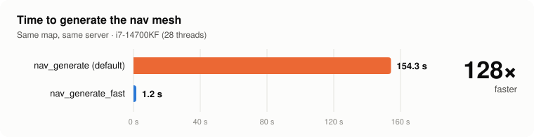
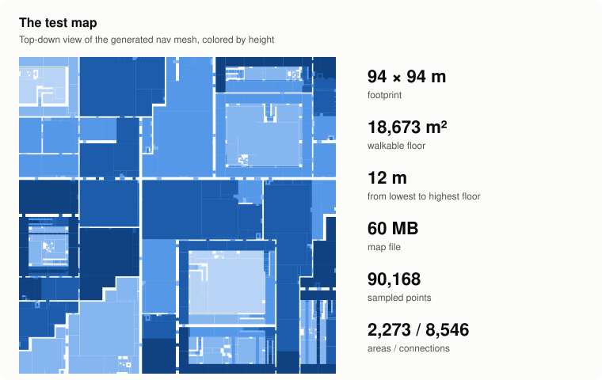
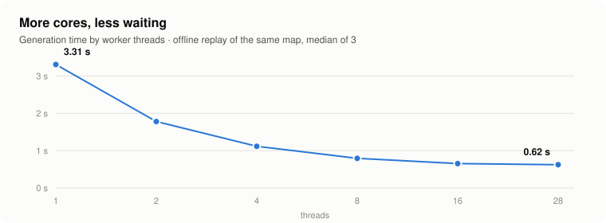
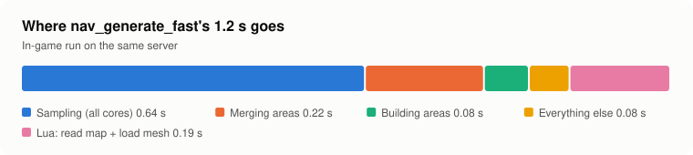

# Faster nav_generate

**Nav meshes in about a second, not minutes.** On a 94 × 94 m, multi-floor map, Garry's Mod's
built-in `nav_generate` took 154 seconds. `nav_generate_fast` built an equivalent mesh in **1.2 seconds**,
**128× faster**, using every CPU core while the server kept ticking.

<picture>
  <source media="(prefers-color-scheme: dark)" srcset="docs/bench/speed-dark.svg">
  
</picture>

## Install

Download `navfast.zip` from Releases and merge its `garrysmod/` folder into your server's.
It includes the module for every server type (32/64-bit, Windows/Linux) and a small addon.

## Use

Run `nav_generate_fast` in the server console, or in game as a superadmin. The mesh is saved
to `maps/<map>.nav` (the old one is kept as `.nav.bak`) and loaded right away.

| Command | What it does |
| --- | --- |
| `nav_generate_fast` | Generate and load the nav mesh for the current map. |
| `nav_generate_fast_mark` | Add where you stand as a starting point, for areas the spawns can't reach. |
| `nav_generate_fast_clear_marks` | Forget all marks. |
| `nav_generate_fast_cancel` | Stop a running generation. |
| `nav_view_fast 1` | Show the mesh in game, like `nav_edit 1`, without `sv_cheats`. |

`nav_generate_fast_threads` sets the worker count (0 = all cores). Vanilla settings like
`nav_slope_limit` still apply.

## Benchmark

All numbers come from the same map and server on an i7-14700KF (28 threads). Vanilla's time is its
own "Generation complete" message; ours runs from the command to the mesh being loaded.

<picture>
  <source media="(prefers-color-scheme: dark)" srcset="docs/bench/map-dark.svg">
  
</picture>

<picture>
  <source media="(prefers-color-scheme: dark)" srcset="docs/bench/scaling-dark.svg">
  
</picture>

<picture>
  <source media="(prefers-color-scheme: dark)" srcset="docs/bench/phases-dark.svg">
  
</picture>

## How it works

It follows the same steps as Valve's `nav_generate`. The difference is that it copies the map's
collision into its own thread-safe structure, so the work runs on all cores instead of in small
slices on the game thread. It doesn't use engine internals, so GMod updates don't break it.
It skips the hiding/sniper-spot analysis that only CS-style bots use. Ladders aren't supported yet.

## Building

CMake 3.25+ and a C++20 compiler: `cmake -S . -B build && cmake --build build --config Release`.
`nav_generate_fast_verify` compares the module's traces against the engine's.
`tools/bench/render.py` regenerates the benchmark charts.

## License

Generation logic is ported from the
[Source SDK 2013](https://github.com/ValveSoftware/source-sdk-2013/blob/master/LICENSE)
and follows its license: free, for Source games.
